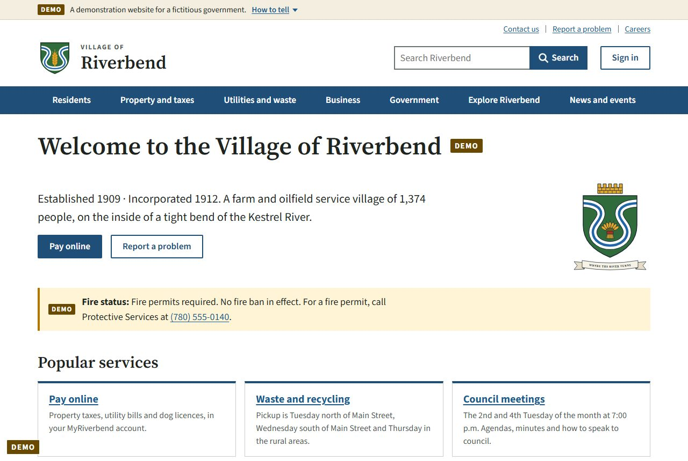
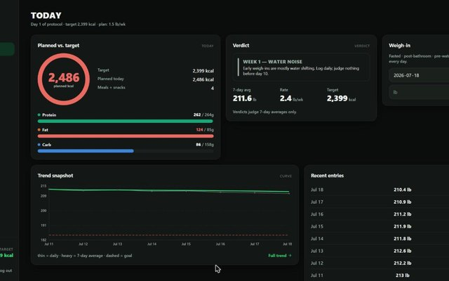

# Hi, I'm Shad

I plan and direct software built with AI, from Edmonton, Alberta. I decide what gets built, who it's for and how it
should work, and AI writes most of the code. My newest work is **Riverbend**, a working demo of a modern website for
small Alberta towns, and **Kinan vs. Mom**, a platformer I made for my little brother.

**Open to tech work in Edmonton or remote.** You can reach me on [LinkedIn](https://www.linkedin.com/in/shad-hunter-422725112/).

---

## Riverbend

A working demonstration of a modern website and resident portal for Alberta's small towns and villages, built for my
business, Blue Sky Digital. Alberta replaced its old privacy law in June 2025, and many small towns' websites still
haven't caught up. Riverbend is a made-up village of 1,374 people that shows the fix working: 83 public pages, council
minutes, property taxes, garbage days, job postings, and an AI assistant that answers only from the village's own pages.

**[Read the story, the market and the money →](https://github.com/AlbertanCoder/riverbend)** · Live demo coming soon

## Kinan vs. Mom

A free platformer I made for my little brother Kinan's 11th birthday: 8 worlds across Canada, 88 levels and 16 bosses
you make friends with, plus Family Kart, Family Brawl and Builder. It plays on phones, tablets and computers.

**[▶ Play it free](https://albertancoder.github.io/kinan-vs-mom/)** · [Screenshots and details](https://github.com/AlbertanCoder/kinan-vs-mom)

## More projects

<table>
<tr>
<td width="33%" valign="top">
 
<b>Sweepwise</b> 
Free, open-source PC care for Windows, Linux and Mac. It clears junk, checks your protection and speeds up your PC.
Nothing personal changes without your OK. 
<a href="https://albertancoder.github.io/sweepwise/">Website</a> · <a href="https://github.com/AlbertanCoder/sweepwise">Code</a>
</td>
<td width="33%" valign="top">
 
<b>Edmonton Tech Academy</b> 
A free course in the browser for getting into tech from zero, with no account needed. 
<a href="https://albertancoder.github.io/hackathon-sim/">Open the course</a> · <a href="https://github.com/AlbertanCoder/hackathon-sim">Code</a>
</td>
<td width="33%" valign="top">
 
<b>Cut Protocol</b> (on hold) 
A nutrition app that sets calorie targets with the math shown, and builds weekly meal plans that fit them. 
<a href="https://github.com/AlbertanCoder/cut-protocol">Code and screenshots</a>
</td>
</tr>
</table>

## How I work

I decide what gets built, who it's for and how it should work. AI (Claude Code) writes most of the code from my plan.
A separate AI reviewer checks each piece before I accept it, and automatic checks run on every change. Riverbend has
820 of them.

---

Edmonton, Alberta · [LinkedIn](https://www.linkedin.com/in/shad-hunter-422725112/)
