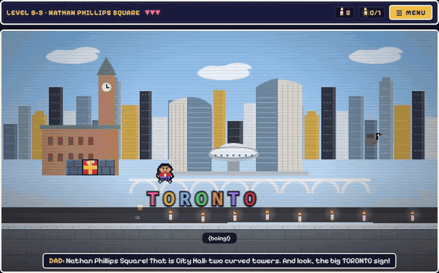
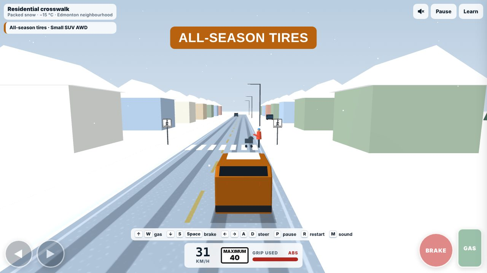
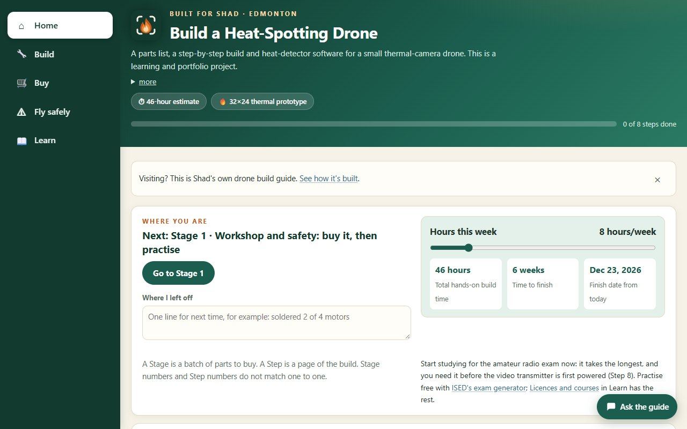
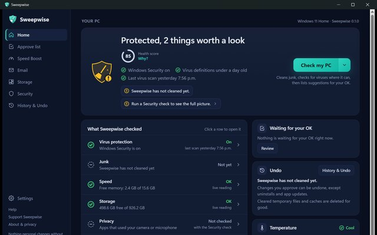
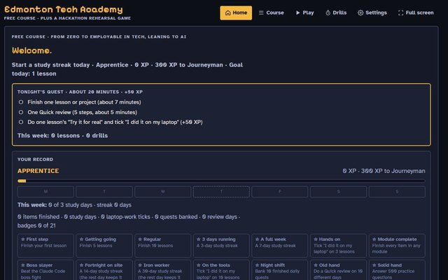

# Hi, I'm Shad

I'm an apprentice carpenter in Edmonton, Alberta, who builds software with AI. I'm not a trained developer. I decide
what gets built and how it should work, AI writes most of the code, and I test it until it holds up. So far that's a
game for my little brother, a winter driving simulator and a budget tool I use myself. Right now I'm building my
first drone, and I wrote the build guide first.

**Open to tech work in Edmonton or remote.** You can reach me on [LinkedIn](https://www.linkedin.com/in/shad-hunter-422725112/).

---

## Kinan vs. Mom

A free platformer I made for my little brother Kinan's 11th birthday. It kept growing: worlds across Canada, bosses
you make friends with, plus Family Kart, Family Brawl and Builder. It plays on phones, tablets and computers.

**[▶ Play it free](https://albertancoder.github.io/kinan-vs-mom/)** · [Screenshots and details](https://github.com/AlbertanCoder/kinan-vs-mom)

## Alberta Winter Tire Challenge

A free 3D winter driving game for Alberta roads. You drive the same icy moment on your own tires and then on winter
tires, in 14 real situations, with the physics taken from published research.

**[▶ Drive it free](https://albertancoder.github.io/alberta-winter-tire-challenge/)** · [Details and code](https://github.com/AlbertanCoder/alberta-winter-tire-challenge)

## Drone build guide

I'm building my first drone, a small one that will carry a thermal camera, and I wrote the build guide first: 8 build
steps, 34 3D lessons with quizzes, a parts list and the Canadian flight rules. The drone itself is not built yet. The
parts are being bought in stages.

**[Open the guide](https://albertancoder.github.io/build-guide/)** · [Details and code](https://github.com/AlbertanCoder/build-guide)

## More projects

<table>
<tr>
<td width="50%" valign="top">
 
<b>Sweepwise</b> 
Free, open-source PC care for Windows, Linux and Mac. It clears junk, checks your protection and speeds up your PC.
Nothing personal changes without your OK. 
<a href="https://albertancoder.github.io/sweepwise/">Website</a> · <a href="https://github.com/AlbertanCoder/sweepwise">Code</a>
</td>
<td width="50%" valign="top">
 
<b>Edmonton Tech Academy</b> 
A free course in the browser for getting into tech from zero, with no account needed. 
<a href="https://albertancoder.github.io/hackathon-sim/">Open the course</a> · <a href="https://github.com/AlbertanCoder/hackathon-sim">Code</a>
</td>
</tr>
</table>

## How I work

I decide what gets built, who it's for and how it should work. AI (Claude Code) writes most of the code from my plan.
A separate AI reviewer checks each piece before I accept it, and automatic checks run on every change.

---

Edmonton, Alberta · [LinkedIn](https://www.linkedin.com/in/shad-hunter-422725112/)
