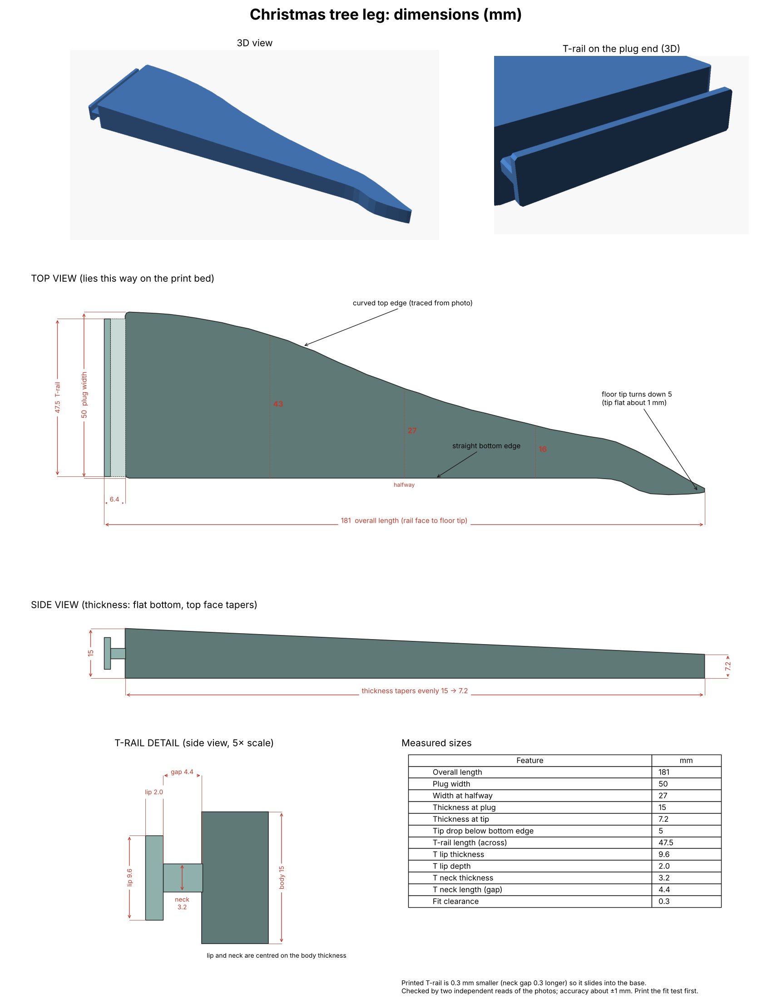

# Christmas tree leg (replacement)

A 3D-printable copy of the leg missing from a small artificial Christmas tree. I measured it from photos of a good
leg next to a tape measure.



## Files

| File | What it is |
|---|---|
| `christmas-tree-leg.stl` | **The one to print.** The whole leg. |
| `fit-test-plug-end.stl` | Only the first 15 mm (the T-rail plus a bit of body). About 7 g. Print this first to check the fit in the tree base. |
| `dimensions.png` | Dimensioned drawing: 3D view, top view, side view, T-rail detail, table. |
| `christmas-tree-leg.scad` | OpenSCAD source. Every size is a named number at the top. |

Both STL files were checked: closed (watertight), every edge shared by exactly two triangles, one solid body.

## Measured sizes (mm)

| Size | Value | How it was read |
|---|---|---|
| Total length (T-rail face to floor tip) | 181 | my read 183, independent read 180 (±3) |
| Plug width (body at the plug end) | 50 | tape across the plug end, three photos (±1) |
| Width at halfway | about 27 | traced from the top-view photo, outer edge of the rim |
| Thickness at the plug | 15 | my read 15.5, independent read 15 (±1.5) |
| Thickness at the tip | 7.2 | side-edge photos |
| Floor tip | turns down about 5 mm below the straight edge | traced |
| T-rail length (across the plug) | 47.5 | starts 0.5 in from the straight edge, ends about 2 in from the curved edge |
| T-rail lip (bar) thickness | 9.6 | 0.63 to 0.64 × body thickness, in four photos |
| T-rail lip depth | 2.0 | both reads agree (±0.5) |
| T-rail neck (stem) thickness | 3.2 | 0.20 to 0.21 × body thickness |
| T-rail neck length (gap behind lip) | 4.4 | read 3.0 to 4.8; kept long so the base wall fits |

**The T is a rail, not a tab.** Seen from the side edge, the plug end has a T-shaped profile that runs across the
whole 47.5 mm width. The rail slides into a matching T-slot in the tree base.

The sizes were read twice, independently, and the two reads agree within about 1 mm on everything that affects the fit. Photos and a tape measure can't do better than about 1 mm, which is why the fit test exists.

## Fit (clearance)

`clearance = 0.3` makes the lip and neck 0.3 mm thinner, the lip 0.3 mm shallower, and the neck 0.3 mm longer, so
the rail slides into the slot. The body is printed at its measured size.

- **Too tight** (won't slide in): set `clearance = 0.5` and export again.
- **Too loose** (wobbles or falls out): set `clearance = 0.15`.
- Rail thickness itself wrong: change `lip_thickness` or `neck_thickness`.

Export from the `.scad` file:

```
openscad -o christmas-tree-leg.stl christmas-tree-leg.scad
openscad -D 'part="fit_test"' -o fit-test-plug-end.stl christmas-tree-leg.scad
```

## Print settings (EPL makerspace, Prusa printer, PrusaSlicer)

- **Material:** PLA.
- **Orientation:** flat, with the big flat face down. This is how the STL loads, so don't rotate it.
- **Walls (perimeters):** 4. **Infill:** 40%.
- **Supports: "Support on build plate only".** The T-rail lip sits about 3 mm above the bed, so it needs a small support
  under it. Nothing else needs support. Snap the support off and clean the rail with a knife or sandpaper.
- **Brim:** optional. Helps the narrow tip stay down.
- **Size:** 181 × 55 × 15 mm. It fits any of the printers.

## Weight and cost (estimate)

| Part | Weight | Cost at $0.10/g (GST included) |
|---|---|---|
| Full leg | about 41 to 45 g | about $4.10 to $4.50 |
| Fit test | about 6 to 7 g | about $0.70 (a $1 minimum may apply) |

The slicer gives the exact weight. 
